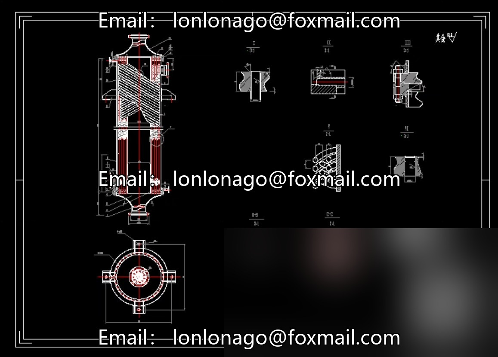
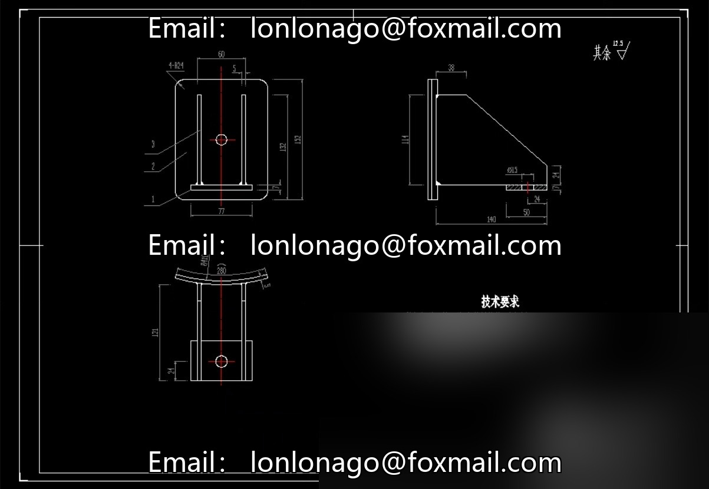
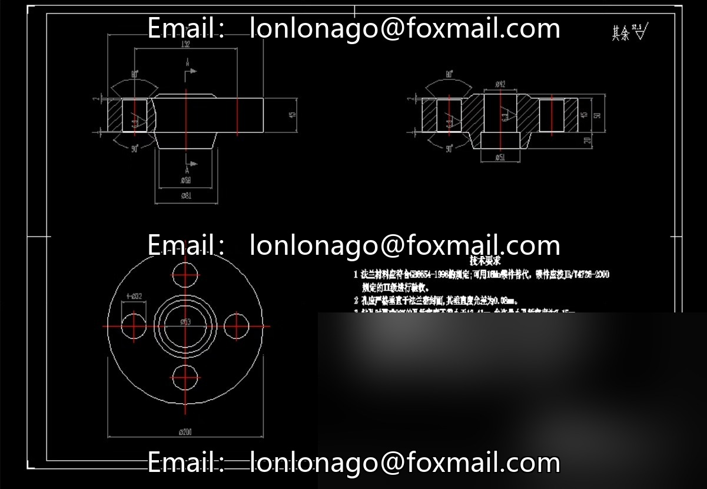

# Winding pipe heat exchanger design

## Body

Wound pipe heat exchanger design; helical wound pipe heat exchanger design; wound pipe heat exchanger design diagram; wound pipe heat exchanger design CAD diagram
This design elaborates on the calculation of the wound pipe heat exchanger, determining a more optimized design through comparisons of different flow velocities and pipe layer counts. Based on the calculation results, the total heat transfer coefficient of the designed heat exchanger is 556, pipe-side pressure loss is 85.7, shell-side pressure loss is 60.2 Pa, and all indicators are controlled within ideal ranges. In addition, design has been carried out for attachments such as central shell, pipe flange, flange, and tube box. 369

The design covers the spiral twisted pipe heat exchanger calculation with comparisons of flow speeds and pipe layers to determine a better scheme; it also provides the overall heat transfer coefficient, side pressure losses, and designs for central cylinders, pipe plates, flanges, pipe boxes, along with technical requirements and material specifications.

<!-- AI_ENRICHED -->

## Images

## Payment

Here is a pay link on Stripe ( https://buy.stripe.com/3cs8yP7sY87d0vu9AB ). Please contact me lonlonago@foxmail.com after funding $89, and I will send you a complete data files , thank you!

